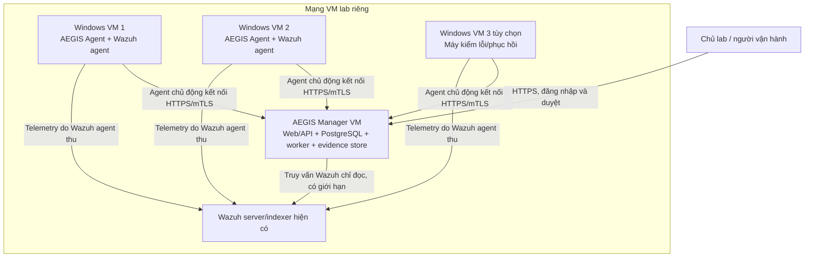
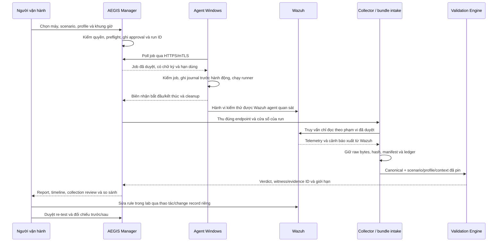
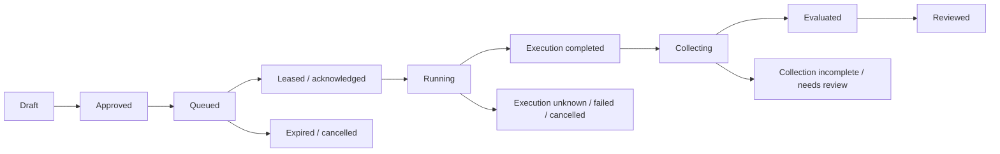

# AEGIS Manager v1 + Agent kiểm thử nhẹ

**Bản thiết kế để duyệt — ngày 21/10/2026**

- Căn cứ phần mềm: `main` @ `e2b11b7ee8ae117d0be3ff039229d8b2ca6a8df0`, core 0.4.0.
- Bối cảnh chủ dự án xác nhận: VM/lab riêng do chủ dự án quản lý, đã dùng Wazuh; mang kết quả đi thi trước khi xét triển khai doanh nghiệp.
- Phạm vi: một AEGIS Manager, hai PC Windows dạng VM, thêm PC thứ ba khi tài nguyên cho phép. Wazuh server/indexer hiện có là hạ tầng phụ thuộc, không nằm trong số VM AEGIS vừa nêu.
- Trạng thái: **đề xuất kiến trúc và kế hoạch pilot**, chưa phải tính năng đã triển khai, nghiệm thu hay một giấy phép chạy trên máy doanh nghiệp.
- Mục tiêu: điều phối một kiểm thử an toàn tới đúng máy; đối chiếu telemetry/cảnh báo qua Wazuh; đưa ra kết luận truy nguyên được bằng chứng và so sánh sau sửa rule.

## 1. Hiểu đúng sản phẩm

| Khái niệm | Nghĩa trong thiết kế này |
| --- | --- |
| AEGIS Manager | Dịch vụ trung tâm quản lý danh tính, phạm vi được phép, tác vụ, bằng chứng, kết quả và audit |
| AEGIS Agent | Dịch vụ nhẹ trên Windows, thực hiện runner đã duyệt và gửi biên nhận; không tự kết luận detection |
| Wazuh agent | Thành phần đang thu telemetry Windows cho Wazuh; tiếp tục giữ vai trò cảm biến |
| Job | Một tác vụ cho một agent; có hạn dùng, quyền, timeout và chống chạy trùng |
| Run | Một lượt nghiên cứu liên kết job, scenario/profile, collection và kết quả đánh giá |
| Evidence | Log/cảnh báo gốc đã thu, có hash, raw reference và evidence ID theo engine hiện có |
| Execution receipt | Biên nhận job bắt đầu/kết thúc, runner, exit code, thời gian và cleanup; không thay evidence của Wazuh |
| Pilot | Thực nghiệm giới hạn để kiểm chứng phần mềm và luồng vận hành, chưa chứng minh production readiness |

**Thông điệp trình bày:** AEGIS điều phối và kiểm chứng các lượt kiểm thử detection trên nhiều endpoint, giữ đường truy nguyên từ kết luận về bằng chứng.

## 2. Lựa chọn kiến trúc

| Phương án | Lợi ích | Giới hạn | Quyết định |
| --- | --- | --- | --- |
| Manager nhập bundle; con người chạy kiểm thử | Ít thành phần mới, nhanh kiểm luồng dữ liệu | Chưa chứng minh điều phối endpoint | Mốc nền để kiểm Manager trước |
| Manager + agent chạy tác vụ giới hạn | Có quản lý thiết bị/tác vụ, giữ lại lõi AEGIS | Cần xử lý danh tính, mất mạng, quyền và cleanup | **Phương án v1 được đề xuất** |
| Manager nhận lệnh tùy ý, thu mọi log và điều khiển toàn bộ PC | Phạm vi rộng | Tăng bề mặt tấn công, trùng chức năng hệ thống khác và vượt bài toán hiện tại | Ngoài v1 |

V1 giới hạn một môi trường lab, một scenario Windows/Wazuh, nhập bundle và đọc Wazuh trong phạm vi được duyệt. Các thay đổi rule vẫn do người quản trị lab thực hiện qua change record riêng.

### Có trong v1

- Đăng nhập, ba vai trò Viewer/Operator/Admin và kiểm quyền trên API.
- Đăng ký/thu hồi agent; trạng thái online, offline, phiên bản và khả năng chạy runner.
- Duyệt chiến dịch, gửi/hủy job, giới hạn concurrency và lịch chạy có thời điểm hết hạn.
- Biên nhận thực thi, collection Wazuh có giới hạn, kho bundle, evaluation và comparison bằng engine hiện tại.
- Timeline, evidence ID, lịch sử baseline/gap/re-test, nhật ký người thao tác.
- Cài/gỡ agent, backup/restore và gói hồ sơ trình bày.

### Ngoài v1

- Shell/PowerShell tùy ý từ xa; tự nâng quyền hoặc sửa rule tự động.
- EDR/SIEM mới, thu liên tục mọi dữ liệu, live Elastic collector.
- Multi-tenant giữa các khách hàng, AI tự quyết định phản ứng, HA và cam kết số lượng endpoint lớn.
- Tự đổi ground truth, manifest `draft`, profile fingerprint hoặc ngoại lệ Lab A/B/C đã chốt.

## 3. Topology pilot

Tên máy, địa chỉ, URL connector và credential nằm trong cấu hình lab riêng. Không đưa giá trị thật vào source hoặc gói phát hành. Dùng mạng VM nội bộ; không đưa dịch vụ Manager ra Internet để phục vụ pilot.

| Máy | Vai trò | Ngân sách tài nguyên khởi điểm, cần đo lại |
| --- | --- | --- |
| Manager VM Linux | Web/API, DB, worker, evidence | 2 vCPU, RAM 4 GB, đĩa 40 GB; mở rộng theo số bundle |
| Windows VM 1 và 2 | Cùng baseline đã duyệt, danh tính tách biệt | Khoảng 2 vCPU, RAM 4 GB/máy; đĩa theo OS, snapshot và chính sách lab |
| Windows VM 3, tùy chọn | Offline/restart/cancel và kiểm thay phiên bản | Chỉ thêm khi host đủ RAM/đĩa |
| Wazuh hiện có | Nguồn telemetry/cảnh báo | Kiểm dung lượng, retention và tài nguyên riêng; chưa có thì phải bổ sung kế hoạch |

Đây là dự toán bố trí VM, không phải benchmark hoặc cấu hình tối thiểu được bảo đảm. Bắt đầu hai PC. Clone VM phải tạo lại danh tính AEGIS và danh tính Wazuh, không dùng chung khóa/certificate giữa các máy.

## 4. Thành phần và công nghệ đề xuất

| Thành phần | Lựa chọn đề xuất | Lý do / ranh giới |
| --- | --- | --- |
| Manager Web/API | Django 5.2 LTS, bản vá còn được hỗ trợ khi bắt đầu build | Có auth, session, CSRF, ORM và migration; giảm phần bảo mật phải tự xây. API agent dùng danh tính máy riêng |
| Web server/TLS | Reverse proxy HTTPS + application server phù hợp | Không công bố server `http.server` loopback hiện tại ra LAN |
| DB | PostgreSQL | Giao dịch, quyền, lịch sử job/approval và phục hồi sau crash |
| Worker | Một process riêng, hàng đợi bền vững trong DB | Quy mô pilot chưa cần thêm Redis/Celery; không chạy evaluation dài trong web request |
| Giao diện | Tái sử dụng React hiện có, bổ sung trang Manager | Dashboard đọc report; quyền vẫn phải được kiểm tại server |
| Engine/connector | Gọi installed core AEGIS đã pin trong worker | Parser nguồn ở `connectors/`; validation chỉ nhận canonical; process/output riêng từng run |
| Agent | Windows Service bằng .NET 10 LTS, build self-contained x64 nếu được duyệt | Không cần Python/Node trên endpoint; kiểm khả năng hỗ trợ đúng bản Windows trước build |
| Kho evidence | Thư mục riêng của service, metadata trong DB | Raw bundle giữ nguyên bytes, có ACL, hash, quota, retention và backup |

Đây là các dependency **được đề xuất**, chưa được thêm/cài. Phải chốt phiên bản, license, SBOM và threat model trước implementation. Django ghi thời hạn extended support của 5.2 LTS đến tháng 4/2028; .NET 10 LTS có vòng đời hỗ trợ đến tháng 11/2028. Kiểm lại patch và OS matrix khi khóa build. [Django support](https://www.djangoproject.com/download/), [.NET support](https://dotnet.microsoft.com/en-us/platform/support/policy/dotnet-core).

Agent mới là sản phẩm service riêng. Launcher demo .NET Framework 4.8 hiện tại không được tự đổi tên thành agent hoặc dùng làm bằng chứng rằng service đã đạt.

Manager lập chỉ mục run trong DB, mỗi run có thư mục/report riêng. Không tăng hoặc bỏ giới hạn intake/report store/Operations hiện tại để giả lập khả năng mở rộng. MSI Agent phải có danh tính sản phẩm và UpgradeCode riêng với MSI ứng dụng cục bộ; v1 cập nhật agent qua thao tác IT/chủ lab được duyệt, chưa có tự cập nhật từ xa.

## 5. Flow điều phối, bằng chứng và kết luận

Agent thành công chỉ là trạng thái thực thi. `Detected`/`Prevented` cần witness theo engine. Không có bằng chứng đủ phạm vi thì không suy thành công, thất bại detection hoặc collection đầy đủ từ heartbeat/exit code.

### Luồng người dùng

1. Admin tạo môi trường và mời/enroll hai máy; ánh xạ AEGIS agent ID với Wazuh agent ID sau đối chiếu.
2. Operator mở trang **Devices**, chọn đúng máy và xem health/preflight.
3. Tạo campaign gồm scenario/profile/runner đã duyệt, danh sách máy, lịch và giới hạn.
4. Admin/chủ lab duyệt campaign; nếu cùng một người giữ hai vai trò phải ghi đúng, không gọi là review độc lập.
5. Trang **Runs** tách cột thực thi, collection và verdict. Có nút cancel và trạng thái cancellation đang chờ xác nhận.
6. Trang **Evidence/Timeline** hiển thị raw reference, hash, EID và nguồn; **Compare** hiển thị baseline/re-test đủ điều kiện so sánh.
7. Export hồ sơ để chủ lab duyệt, sau đó mới xuất bản trình bày đã ẩn dữ liệu nhạy cảm.

## 6. Danh tính, quyền và job contract

### 6.1 Đăng ký agent

- Admin tạo mã enrollment một lần, thời hạn ngắn, gắn với môi trường và máy dự kiến.
- Agent tạo private key tại máy; gửi CSR qua kênh đã xác minh Manager, nhận certificate riêng. Ghi mapping ID/khóa sau khi chủ lab đối chiếu máy.
- Private key nằm trong Windows certificate/key store với ACL cho service identity; không gửi private key lên Manager, không nhúng vào MSI/source/log.
- CA lab chỉ được tin cậy trong các VM được duyệt; không tắt xác minh TLS. Khóa CA và khóa ký job có mục đích, quyền và backup riêng.
- Agent mở kết nối ra Manager; không mở cổng lệnh vào PC. Manager kiểm trạng thái thu hồi trước cấp job; có quy trình hết hạn/đổi khóa/enroll lại sau restore VM.

### 6.2 Quyền

| Vai trò | Quyền |
| --- | --- |
| Viewer | Đọc report đã được cấp; xem raw evidence cần quyền riêng |
| Operator | Tạo yêu cầu, xem các run thuộc phạm vi, yêu cầu cancel; không quản lý CA/credential |
| Admin/chủ lab | Duyệt phạm vi, runner/profile release, enroll/revoke và cấp quyền |
| Agent | Chỉ nhận/ack job của chính nó, gửi receipt; không duyệt job hay đọc evidence của máy khác |
| Collector | Wazuh credential chỉ đọc đúng nguồn được duyệt; credential không xuất hiện ở browser/agent |

Cài service cần quyền quản trị VM. Runtime dùng service identity quyền thấp có ACL riêng; không mặc định LocalSystem/admin cho mọi runner. Runner cần quyền cao nằm ngoài pilot ban đầu cho đến khi có review riêng.

### 6.3 Job đã ký

Job envelope tối thiểu có: protocol version; job/run/environment/agent ID và enrollment generation; scenario fingerprint; runner ID/version/hash; profile hash; tham số có kiểu và target alias đã duyệt; approval ID; not-before/expiry; timeout; payload hash; signing-key ID và chữ ký.

Agent chỉ chấp nhận runner có sẵn trong catalog release đã duyệt, kiểm schema, chữ ký, hạn dùng, agent đích và parameter allowlist. Không nhận chuỗi shell, script tùy ý, đường dẫn thực thi tùy ý hay tự tải plugin theo job. Không dùng `ExecutionPolicy Bypass` để chạy qua chính sách Windows.

Thêm/sửa bytes hoặc ký lại một script tạo ra revision cần pin/review lại; không tái sử dụng approval/hash cũ. Ground truth và các profile hiện tại không tự thay đổi theo yêu cầu job.

## 7. State machine và phục hồi

Các trạng thái trên là quản lý tác vụ. Verdict canonical (`Detected`, `Prevented`, `Missing telemetry`, `False negative`, `Inconclusive`...) vẫn theo engine và được lưu riêng.

- Agent ghi journal bền vững trước bước có tác dụng; retry HTTP không tạo một execution mới. ACK/receipt dùng idempotency key và được lưu theo job ID.
- Mất mạng sau khi bắt đầu hoặc crash giữa ghi journal/hành động có thể để execution **unknown**. Không hứa exactly-once; không tự gửi lại hành động chưa rõ đã chạy hay chưa. Người vận hành phải reconcile rồi duyệt lượt mới.
- Lease hết hạn không chứng minh tác vụ chưa chạy. Manager restart phải khôi phục trạng thái từ DB và đối chiếu agent journal.
- Restore backup khác restart thông thường: giữ VM agent tách mạng, Manager ở chế độ maintenance không dispatch; đối chiếu/reconcile các lease cũ, thu hồi/enroll lại theo generation mới rồi mới mở queue. Không để việc rollback DB/journal biến job cũ thành hành động được chạy lại.
- Agent không bắt đầu job mới khi không xác thực được quyền/phạm vi hiện hành. Job đã chạy có deadline cục bộ, dù Manager mất kết nối.
- Cancel từ Manager khi mất mạng là yêu cầu đang chờ; local timeout/stop tại PC là cơ chế dừng cuối cùng. Không hứa dừng từ xa tức thời khi agent offline.
- Worker trên PC dùng cơ chế sở hữu process tree và cleanup đã kiểm; không kill theo tên process hoặc dừng process ngoài job của nó.
- Giới hạn pilot ban đầu: một job thực thi toàn môi trường và tối đa một job/agent; một collection worker. Kiểm hai job đồng thời chỉ bật ở bước thử riêng sau khi correlation đã đạt.
- Khóa theo endpoint/run bao trùm cả cửa sổ collection và buffer/cooldown đã duyệt, không chỉ lúc process chạy. Không bắt đầu lượt kế tiếp trên cùng PC trong khi nguồn của lượt trước còn có thể bị gộp vào cửa sổ đang đánh giá.

## 8. Dữ liệu và ranh giới tin cậy

Manager lưu riêng: inventory/enrollment; scenario/runner/profile releases; approval; jobs/executions; collection requests; bundle manifests/ledger; evaluation/comparison; audit.

Mỗi run ghi code version, scenario/profile/runner hashes, AEGIS/Wazuh agent mapping, execution identity, cửa sổ thời gian, source/ingest timestamps, collection scope và các artifact hashes. Không sửa raw event hoặc đoán field canonical còn thiếu; trường thiếu vẫn `null` theo contract.

`job_id` nằm trong receipt không tự trở thành raw evidence ID hoặc bằng chứng run binding. Hash/chữ ký xác nhận bytes/nguồn gửi theo khóa được tin cậy; không chứng minh endpoint sạch hoặc upstream đã thu đủ log. Nếu agent bị chiếm quyền, receipt của nó có thể không phản ánh sự thật.

Giữ collection assurance và run binding đúng mức engine hỗ trợ. Chỉ người có thẩm quyền mới khai báo completeness cho đúng scope sau đối chiếu; không tự nâng từ `unknown` vì agent online hoặc số đếm khớp.

Raw bundles giữ nguyên, không ghi đè; report được tạo thành revision mới khi đổi context/attestation. Ghi audit ai làm gì, lúc nào, approval/run nào và input hashes. Append-only ở tầng ứng dụng cùng backup chưa phải WORM hay khả năng chống root sửa dữ liệu.

Agent spool/journal đặt ngoài Program Files với quota và ACL; chỉ dọn spool đã được Manager xác nhận nhận đúng hash theo policy. Không xóa Wazuh log hay dữ liệu ứng dụng khác. Đồng hồ Manager/PC/Wazuh phải được kiểm trước từng campaign; ngưỡng clock-skew cần duyệt, không nới cửa sổ profile để che lỗi giờ.

## 9. Scenario đầu tiên và điều kiện mở pilot

Ứng viên đầu: **SCN-001 PowerShell Execution**, manifest hiện tại 0.1.0, có A01 telemetry process, A02 script/command và A03 Wazuh detection. Payload phải là script an toàn đã được duyệt.

**Điểm chặn thực tế:** demo công khai hiện có không mang private study/evidence đầy đủ của SCN-001. Profile/runner của bộ v3 có ràng buộc lab riêng; không giả định bê nguyên sang VM mới sẽ đúng.

Trước lượt live cần:

1. Khôi phục hoặc chuẩn bị runner/kit an toàn, profile/context đúng lab mới và được chủ lab duyệt; pin toàn bộ hashes.
2. Giữ fingerprint manifest và logic assertion; thay binding lab không phải tự đổi ground truth. Lưu review profile/context theo quy trình hiện có.
3. Đối chiếu mapping máy, nguồn Sysmon/PowerShell/Wazuh, rule revision và khả năng xuất archive cần thiết.
4. Chốt danh tính chạy service/runner, ACL, quyền, cleanup và chính sách thực thi script.
5. Sao lưu rule trước sửa; có bước trả rule về baseline và kiểm Wazuh hoạt động lại.

SCN-001 v3 trước đây có run binding `unknown`; enrollment/job ID mới không tự chữa giới hạn đó. Run mới cần evidence và review mới. Không dùng attestation cũ cho VM, cửa sổ hoặc lượt chạy mới. Xem [hồ sơ SCN-001 v3](../../SCN001_V3_RESULT_2026-09-27.md).

Nếu thiếu kit/profile được duyệt, chỉ kiểm Manager bằng bundle/replay có nhãn rõ; chưa nhận là đã đạt live pilot.

## 10. Kế hoạch pilot 1 Manager + 2–3 PC

### Giai đoạn P0 — Chuẩn bị và quyền

- Ghi inventory VM, phiên bản Windows/Wazuh, snapshot, chủ sở hữu, mạng thử nghiệm và license đang dùng.
- Chủ lab ký/ghi xác nhận phạm vi thử: máy, scenario, thời gian, dữ liệu, stop conditions và người xử lý sự cố. Đây là mẫu chờ xác nhận, không phải chữ ký đã có.
- Kiểm backup/restore cơ bản, đồng hồ, disk/quota, Wazuh agent mapping và credential chỉ đọc.
- Xác định máy PC1/PC2; PC3 chỉ thêm sau khi tài nguyên đáp ứng.

### Giai đoạn P1 — Manager và nhập bundle

- Kiểm login/roles, API authorization, evidence ACL, audit và upload giới hạn.
- Nhập bundle đã review; kết quả canonical phải giữ đúng behavior hiện tại, đối chiếu bằng fixture/replay đã pin khi phù hợp.
- Không chuyển dashboard loopback thành server mạng chỉ bằng đổi host binding.

### Giai đoạn P2 — Enroll và lượt live đầu

- Enroll từng PC bằng danh tính riêng, thử revoke/expiry rồi khôi phục theo runbook.
- Một job trên PC1, sau đó PC2. Xem cả execution receipt và nguồn Wazuh độc lập.
- Chỉ mở campaign lặp lại sau khi preflight, cleanup, source mapping và review bằng chứng của lượt đầu đạt.

### Giai đoạn P3 — Campaign trước/sau sửa rule

Mỗi PC: **5 lượt baseline + 1 lượt biến thể gap + 5 lượt re-test sau sửa rule = 11 lượt**. Hai PC là 22 lượt; ba PC là 33 lượt. Tất cả chạy trong campaign được duyệt; nhóm fault test tính riêng.

Chạy xong pha baseline/gap trên tất cả PC trước khi đổi rule dùng chung; sau đó đóng băng revision đã sửa cho toàn bộ pha re-test. Ghi thời điểm thay/restart rule và chờ nguồn Wazuh khỏe lại trước duyệt job mới.

- Baseline dự kiến có witness detection theo profile đã duyệt.
- Biến thể gap cần telemetry và review collection. Chỉ công nhận `False negative` khi đúng điều kiện/assurance của engine; nếu chưa đủ thì giữ `Inconclusive` và ghi nguyên nhân.
- Người quản trị lab sửa rule qua thao tác riêng có backup/change record.
- Re-test dùng đúng biến thể, phiên bản và phạm vi so sánh đã ghim. `Regression Passed` chỉ khi engine xác nhận đủ điều kiện; không đặt nhãn thành công từ UI hoặc exit code.
- Đối chiếu kết quả giữa PC theo mapping/profile của từng máy; chưa suy là mọi stack/OS tương đương.

### Giai đoạn P4 — Fault test và phục hồi

| Mã | Tình huống | Kỳ vọng cần kiểm |
| --- | --- | --- |
| F01 | Agent offline trước nhận job | Job không chạy trên máy khác; UI thể hiện unavailable/expired |
| F02 | Mất mạng sau bắt đầu | Không tự chạy trùng; reconcile trạng thái execution unknown |
| F03 | Manager/worker restart | Khôi phục DB, không mất approval/receipt, không gửi lại hành động mơ hồ |
| F04 | Gửi lặp job/receipt | Agent journal và API idempotency bảo vệ; số execution được đối chiếu |
| F05 | Token/certificate sai hoặc thu hồi | Không enroll/nhận job trái phép; có audit |
| F06 | Job hết hạn, sai agent/hash/chữ ký hoặc tham số ngoài allowlist | Từ chối trước thực thi, không fallback shell |
| F07 | Runner lỗi/timeout/cancel | Chỉ process tree thuộc job bị dừng; dữ liệu/log giữ theo policy |
| F08 | Wazuh chậm, mất nguồn, query bị giới hạn hoặc credential sai | Collection incomplete/error thể hiện riêng; không tự kết luận detection thất bại |
| F09 | Clock skew không đạt preflight | Chặn/quarantine lượt; không sửa thời gian nguồn hoặc nới profile âm thầm |
| F10 | Đầy đĩa/quota hoặc artifact upload hỏng | Fail rõ, không ghi đè bundle cũ; hash sai bị từ chối |
| F11 | Agent A gửi dữ liệu/receipt giả danh B; người Viewer gọi API Admin | Từ chối truy cập chéo và lưu audit |
| F12 | Restore Manager/agent từ backup | Thu hồi/enroll lại khi cần; không dùng lại job cũ hoặc khóa clone sai danh tính |

Một lượt đồng thời trên PC1/PC2 là thử bổ sung có phê duyệt, sau P3; phải chứng minh evidence không lẫn giữa run. Không suy hiệu năng hàng trăm máy từ thử hai PC.

### Giai đoạn P5 — Đánh giá và nghiệm thu pilot

| Điều kiện | Cách ghi nhận |
| --- | --- |
| Đúng máy, đúng runner, đúng phạm vi | Inventory, approval, journal/receipt và Wazuh mapping đối chiếu từng run |
| Kết luận có bằng chứng | 100% verdict có ledger/input hashes và witness hoặc lý do thiếu evidence theo engine |
| Lặp lại/cancel/crash không gây hành động trùng ngoài ý muốn | Execution records và fault-test artifacts được review; trạng thái unknown được giữ đúng |
| Bảo toàn dữ liệu và process ngoài job | So sánh sentinel/hashes và kiểm tiến trình/listener sau cleanup |
| Isolation/quyền | F05/F06/F11 đạt; không có quyền chéo máy/môi trường trong scope pilot |
| Baseline/gap/re-test | Kết quả đủ điều kiện được so sánh; trường hợp không đủ phải ghi giới hạn, không nâng nhãn |
| Khôi phục | Có kiểm restore thực tế Manager DB/config và một agent/VM, không chỉ có file backup |
| Tài nguyên | Đo CPU/RAM, thời gian nhận job, trễ Wazuh, dung lượng và số lỗi; mục tiêu nhàn rỗi đề xuất CPU trung bình dưới 1%, RAM agent dưới 150 MB, cần hiệu chỉnh theo số đo |

Mục tiêu tài nguyên chỉ tính service AEGIS Agent, tách khỏi runner, Wazuh agent và OS; không phải số liệu đã đo. Theo dõi nhàn rỗi 24–48 giờ giúp tìm lỗi cơ bản, chưa chứng minh độ ổn định dài hạn.

## 11. Hồ sơ giữ lại và phương án đi thi

Giữ: inventory; approval; source/installer/runner/profile versions và hashes; job/execution/collection records; raw bundles riêng; reports/comparisons; audit; fault-test logs; resource measurements; ảnh/video; backup inventory/hashes và kết quả restore.

Backup Manager gồm DB, cấu hình, artifact catalog, evidence và khóa cần phục hồi dưới dạng được bảo vệ; khóa không nằm trong ZIP trình bày. Có ít nhất một bản backup độc lập với đĩa VM đang chạy. Snapshot là điểm phục hồi lab, không thay backup độc lập. Chỉ xóa VM sau khi chủ lab duyệt hồ sơ và việc khôi phục.

Buổi thi 8–10 phút nên gồm: topology và mục tiêu; một lượt live có giới hạn nếu điều kiện cho phép; campaign Gap/Fix/Re-test đã ghi lại và có hash; một ví dụ offline/fault; kết luận và giới hạn.

- Phân biệt trên màn hình **live run**, **historical lab evidence** và **synthetic/offline replay**.
- Chuẩn bị video và bundle đã ẩn thông tin cho trường hợp mạng/VM lỗi.
- Không giảm cửa sổ collection hay khai completeness để vừa thời lượng buổi thi. Nếu Wazuh chưa đủ dữ liệu, trình bày trạng thái chờ/thiếu và dùng hồ sơ lịch sử có nhãn rõ.
- Nội dung chia sẻ không có credential, certificate/private key thật hoặc raw evidence chưa được phép. Quy định cuộc thi và quyền đối với tài nguyên của trường/nhóm cần được đối chiếu trước khi nộp.

## 12. Ước lượng triển khai

**Giả định:** một người phát triển có kinh nghiệm làm toàn thời gian khoảng 40 giờ/tuần, có người hỗ trợ test/review lab, core/Wazuh hiện có dùng được, giữ một scenario, chưa triển khai doanh nghiệp. Các số dưới là ước lượng kỹ thuật, không phải lịch cam kết.

| Hạng mục | Ngày công ước lượng |
| --- | --- |
| Chốt scope, contract, threat model và quyền lab | 3–5 |
| Manager: auth/RBAC, DB, jobs, audit và UI nền | 7–10 |
| Agent: enrollment, service, runner, journal, ký job và cleanup | 8–12 |
| Wazuh, intake, evaluation và comparison end to end | 5–7 |
| Fault/security tests, đóng gói, rollback và tài liệu | 5–7 |
| Campaign pilot, restore, review và hồ sơ thi | 4–5 |
| **Tổng trước dự phòng** | **32–46 ngày công** |

Với dự phòng khoảng 20%, nên lập lịch **8–12 tuần** cho pilot đầy đủ. Nếu thiếu kit SCN-001 riêng, kỹ năng service/PKI, RAM lab hoặc người review thì phải ước lượng lại.

| Mốc cần đạt | Thời gian dự kiến và giới hạn |
| --- | --- |
| Prototype trình bày rút gọn | Khoảng 2–3 tuần: một scenario, tác vụ do người vận hành duyệt, enrollment thủ công, agent có thể chạy foreground; vẫn phải có xác thực, giới hạn và stop. Chưa đạt toàn bộ service/MSI/recovery/pilot gates |
| Manager v1 + service agent và pilot theo tài liệu | 8–12 tuần với giả định nhân lực ở trên |
| Chỉ cài lên lab khi artifact/runbook đã có | Khoảng 1–2 ngày chuẩn bị và cài, sau đó 5–10 ngày làm việc chạy/review pilot; khoảng này nằm trong lịch pilot, không cộng hai lần |
| Đưa lên PC doanh nghiệp | Ước lượng riêng sau pilot: còn approval, policy EDR/ký số, tài khoản, dữ liệu, hỗ trợ và yêu cầu cấp phép theo hoạt động |

Làm bán thời gian cần đổi ngày công thành số giờ thực có; không áp lịch toàn thời gian cho một người chỉ làm vài giờ mỗi tuần. Ngày thi chưa được cung cấp, nên chưa đặt deadline theo lịch.

## 13. Quyền thử nghiệm, bản quyền và cấp phép

### 13.1 Lab riêng và cuộc thi

Với VM/lab do bạn quản lý, bạn là người quyết định phạm vi thử đối với tài nguyên thực sự thuộc quyền của mình. Lưu xác nhận phạm vi, snapshot/rollback và stop conditions. Quyền quản trị một VM không tự cấp quyền thử lên mạng ngoài lab, dữ liệu của người khác hoặc hệ thống Wazuh mượn của đơn vị khác.

Khi đi thi, kiểm quy định về network/live demo, sử dụng tài nguyên, công bố dữ liệu và quyền tác giả của nhóm/trường. Mặc định dùng lab cô lập và dữ liệu trình bày đã làm sạch. Sang PC doanh nghiệp cần văn bản/phê duyệt của người có thẩm quyền về cài service, chạy kiểm thử và thu/xử lý log.

Phiếu phạm vi lab tối thiểu, để chủ lab điền trước campaign:

| Trường | Nội dung cần ghi |
| --- | --- |
| Chủ lab/người duyệt | Họ tên, vai trò và căn cứ quyền quản lý VM/mạng/dữ liệu |
| Tài nguyên được phép | Inventory PC1/PC2/PC3, Manager và Wazuh; VM/network scope rõ |
| Nội dung thử | Scenario, runner/profile hashes, số lượt, thời gian và quyền cần dùng |
| Điều kiện dừng | Tác động ngoài scope, cleanup lỗi, nguồn Wazuh bất thường, thiếu đĩa hoặc sai danh tính |
| Dữ liệu và khôi phục | Nơi giữ evidence, ai đọc được, bản backup và bước trả rule/VM về baseline |
| Xác nhận | Người duyệt và thời điểm; người thực hiện ghi nhận kết quả, không tự coi phiếu trống là approval |

### 13.2 License phần mềm

AEGIS hiện mang Apache-2.0. License này cho phép sử dụng, sửa đổi và phân phối, kể cả thương mại, theo điều kiện của license; khi phân phối cần giữ LICENSE/NOTICE và thông báo sửa đổi phù hợp. Đây không phải quyền thử nghiệm hệ thống của người khác hoặc kết luận miễn giấy phép kinh doanh. [Apache-2.0](https://www.apache.org/licenses/LICENSE-2.0).

| Hạng mục | Việc cần làm trước dùng/phân phối |
| --- | --- |
| Core AEGIS và thư viện hiện có | Giữ license/notice từng thành phần; đối chiếu đúng binary/SBOM, không coi Apache-2.0 bao phủ mọi dependency |
| Manager framework/DB và agent runtime mới | Kiểm license, pin và notice của đúng phiên bản được chọn. PostgreSQL có license mở cho sử dụng/phân phối theo điều kiện của nó. [PostgreSQL license](https://www.postgresql.org/about/licence/) |
| Wazuh | Dùng hệ thống hiện có qua interface, ghi phiên bản; nếu đóng gói lại code/binaries của Wazuh thì review nghĩa vụ của license tương ứng. [Wazuh license](https://github.com/wazuh/wazuh/blob/master/LICENSE) |
| Windows VM và hypervisor | Dùng quyền sử dụng hợp lệ; quyền trên máy host không tự chứng minh license cho mọi VM. Microsoft có Windows 11 Enterprise evaluation 90 ngày với điều kiện riêng. [Windows evaluation](https://www.microsoft.com/en-us/evalcenter/evaluate-windows-11-enterprise) |
| TLS và code signing | Lab có thể dùng CA riêng được tin cậy trong VM theo chính sách lab; không tắt xác minh TLS. Chứng thư TLS và chứng thư ký EXE/MSI là hai mục đích khác nhau; yêu cầu mua/chấp nhận chứng thư ký phụ thuộc mô hình phát hành/chính sách nơi chạy |

Chưa có yêu cầu mua license theo số agent của riêng AEGIS trong source hiện tại. Chi phí OS, hạ tầng, công cụ/phiên bản được chọn và chứng thư phát hành phải được tính riêng khi thực sự chọn chúng.

### 13.3 Khi chuyển sang doanh nghiệp hoặc thương mại tại Việt Nam

Đối chiếu pháp lý theo bối cảnh Việt Nam ngày 21/10/2026; đây là rà soát sơ bộ, không phải quyết định phân loại/cấp phép của cơ quan có thẩm quyền.

Nghị định **332/2026/NĐ-CP**, hiệu lực 19/8/2026, quy định nhóm sản phẩm/dịch vụ kiểm tra, đánh giá an ninh mạng và điều kiện kinh doanh liên quan. AEGIS phân tích log và kiểm chứng detection nên **cần rà soát khả năng thuộc phạm vi này khi đưa ra thị trường/cung cấp dịch vụ**; đây là suy luận theo chức năng, chưa phải phân loại chính thức. Không suy từ mã nguồn mở hoặc pilot miễn phí rằng hoạt động thương mại tự được miễn. [Toàn văn và phạm vi Nghị định](https://xaydungchinhsach.chinhphu.vn/nghi-dinh-332-2026-nd-cp-quy-dinh-hoat-dong-kinh-doanh-san-pham-dich-vu-an-ninh-mang-119260821142435926.htm), [điều kiện kinh doanh](https://xaydungchinhsach.chinhphu.vn/dieu-kien-kinh-doanh-san-pham-dich-vu-an-ninh-mang-11926082115244946.htm).

Luật Bảo vệ dữ liệu cá nhân **91/2025/QH15** có hiệu lực từ 1/1/2026. Nếu xử lý log gắn với cá nhân thật, cần rà mục đích/cơ sở xử lý, quyền truy cập, lưu giữ và việc chia sẻ theo trường hợp cụ thể. Pilot ưu tiên tài khoản lab và dữ liệu tối thiểu. [Văn bản và ngày hiệu lực](https://vanban.chinhphu.vn/?classid=1&docid=214590&pageid=27160&typegroup=).

Trước nhận triển khai/bán sản phẩm cho doanh nghiệp: có review pháp chế hoặc cơ quan có thẩm quyền về phân loại sản phẩm/dịch vụ; quyền phần mềm/dữ liệu; nghĩa vụ xử lý dữ liệu; và hồ sơ kinh doanh áp dụng. Các giấy phép phát hành/cấp phép kinh doanh không được suy ra từ việc EXE/MSI chạy thành công. Phần này là gate cho bước sau, không phải yêu cầu nộp hồ sơ cấp phép thương mại để bắt đầu viết thiết kế lab hiện tại.

## 14. Rủi ro và quyết định còn cần chốt

| Rủi ro | Cách xử lý trong phạm vi thiết kế |
| --- | --- |
| Kit/profile SCN-001 riêng chưa sẵn sàng | Chặn live pilot; khôi phục/review trước hoặc giữ mốc nhập bundle có nhãn |
| Tác vụ từ xa tạo bề mặt tấn công | Identity, quyền trên API, signed allowlisted job, expiry, giới hạn và thu hồi |
| Agent/Manager bị chiếm quyền | Receipt không đủ làm ground truth; giữ nguồn Wazuh độc lập, audit/backup và threat-model review; chưa có hardware attestation |
| Mất mạng và chạy trùng | Journal bền vững, idempotency, execution unknown và reconcile có người duyệt |
| VM thiếu tài nguyên hoặc clock drift | Pilot hai máy trước, preflight và đo riêng; không che bằng sửa profile |
| Demo thi phụ thuộc ingest/network | Dự phòng replay/video có nhãn và hash; không dựng log hay nâng nhãn |
| Phạm vi nở thành quản trị endpoint toàn diện | Giữ một môi trường, một scenario và catalog runner có giới hạn |

Các quyết định để người duyệt xác nhận: Windows version/nguồn license; tài nguyên host; Wazuh/version/khả năng lấy archive; kit/profile được duyệt; người phát triển và giờ công; ngày thi; dependency stack, định dạng/thuật toán ký job, giá trị TTL/timeout và quyền chạy service. Đây là các mục cấu hình/phê duyệt còn mở của **bản thiết kế**, không phải lỗi hoặc sự cố đã xảy ra.

## 15. Điều kiện chuyển sang implementation

- [ ] Chủ dự án duyệt phạm vi Manager v1, agent và topology lab trong tài liệu này.
- [ ] Xác nhận scenario/kit/profile, authority và dữ liệu; không mặc định đã có phê duyệt thực thi.
- [ ] Chốt milestone trình bày rút gọn hay pilot đầy đủ theo nhân lực/ngày thi.
- [ ] Viết và duyệt implementation plan theo từng issue sau khi thiết kế được chấp thuận.
- [ ] Triển khai bằng thay đổi nhỏ, tests và review; chỉ chạy lab trong campaign được duyệt.

**Tiêu chí chốt pilot:** chứng minh được chuỗi duyệt → đúng agent → thực thi giới hạn → thu bằng chứng Wazuh → verdict có EID → re-test/compare, đồng thời xử lý được các tình huống lỗi đã liệt kê và khôi phục được hồ sơ. Những điều chưa đo hoặc chưa review được ghi thành giới hạn.
