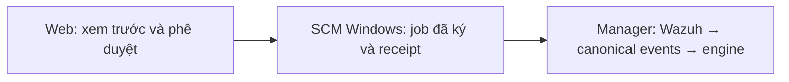

# Chạy SCN-001 từ web trên một Windows đã ghép nối

Ngày: 2026-10-25. Trạng thái: **Owner đã duyệt thiết kế và yêu cầu triển khai**.
Issue thực thi: [#161](https://github.com/Tindaptrai/aegis-verify/issues/161).
Mốc khảo sát mã nguồn: `7c6fbe80`; tài liệu này không tuyên bố đã triển khai hay kiểm chứng lab.
Tên `WIN-DEMO-01` trong tài liệu và mockup là dữ liệu minh họa.

## 1. Quyền phê duyệt, mục tiêu và giới hạn

Owner đã chọn hướng Manager Django/React, agent tự khởi động, Windows chạy SCN-001,
Linux Online và catalog ZIP trong thiết kế ngày 2026-10-23; amendment ngày 2026-10-24
đã thay mặc định foreground bằng SCM/systemd và giữ agent mới ở mức presence-only.
Owner đồng ý chuẩn bị thiết kế chi tiết và mockup trước. Các cơ chế bên dưới là đề xuất
kỹ thuật cần duyệt tài liệu, không phải quyền sửa production, chạy lab hoặc chuyển máy thật.

Lát cắt này hoàn thành luồng **một Windows đã paired → một phê duyệt web → receipt →
Wazuh collection → engine hiện có**. Máy chạy trước đăng nhập nhờ SCM, không cần mật
khẩu tài khoản web trên endpoint. Mỗi lần chỉ chọn một Windows và một job toàn hệ thống.
Chạy batch, thực thi Linux, shell tương tác và thực thi ZIP bất kỳ thuộc lát cắt sau.
Catalog vẫn nhận/phát hành gói theo hợp đồng hiện có; publication không cấp quyền thực thi.

Giữ nguyên ground truth, hồ sơ pilot, key/cert, signed bytes và lịch sử v1. Không biến
paired identity thành legacy để chạy được; không suy ra mapping bằng hostname hay IP.
Tài liệu tuân thủ `docs/PRD.md`, `docs/ARCHITECTURE.md` và hai thiết kế đã duyệt nói trên.
Đầu vào khảo sát bổ sung: `manager-notes.txt`, `windows-notes.txt`, `mockup-notes.txt`
trong bộ review `AEGIS-Windows-Web-Job-Design-20261025-r1` ở Downloads của owner.

## 2. Phương án kiến trúc và cơ sở tái sử dụng

Chọn mở rộng Django Manager và C# SCM hiện có với một adapter SCN-001 được pin chính xác.
Tái sử dụng Job, approval, receipt, collector, canonical intake và engine; không thêm queue,
web framework, database hay runtime dependency. `agent/connection` giữ paired identity;
`agent/windows/Aegis.Agent` cung cấp ngữ nghĩa kiểm tra/chạy SCN-001 cần tách core có test.
Không gọi executable legacy `--once` dưới service: nó dùng CurrentUser certificate khác.

Một execution service và account riêng tạo biên cách ly mạnh hơn, nhưng cần broker quyền,
IPC, bộ cài và phục hồi riêng. Đây là phương án phải chọn nếu yêu cầu bảo vệ identity khỏi
payload ngay trong lát cắt này. Foreground CLI không đáp ứng chạy trước đăng nhập.
Đề xuất hiện tại dùng cùng virtual account `NT SERVICE\AegisAgent` cho adapter và payload
SCN-001 đã review. Child có quyền của cùng SID đối với identity/journal; tách thư mục hoặc
không truyền key qua argv không ngăn child cùng SID đọc chúng. Job Object chỉ quản lý vòng
đời process, không phải security sandbox. Chỉ chấp nhận đúng built-in bytes đã pin;
generic ZIP cần thiết kế execution identity/broker riêng trước khi bật.

Các điểm neo nguồn: `manager/control/{models,jobs,worker,collection}.py`,
`manager/devices/{services,identity,contracts,archive}.py`, `manager/catalog/contracts.py`,
`agent/connection/Aegis.Connection`, `agent/windows/Aegis.Agent`, `demos/scn-001`.
Worker hiện chỉ hiểu v1; DTO presence/catalog kín và báo execution_supported false.
Vì vậy phải thêm adapter v2 rõ ràng, không đổi ngầm ý nghĩa DTO hoặc auto-detect protocol.

## 3. Binding thực thi và quyền sở hữu target

Thêm `DeviceExecutionBinding` có UUID, revision tăng đơn điệu, enabled, device FK,
UUID/generation/fingerprint/environment được duyệt, provider `reviewed-scn001-windows/1`,
RunnerRelease tham chiếu, immutable release snapshot digest, installation-profile digest,
artifact-set digest, connection ID/revision, Wazuh agent ID, reviewer/time. Giữ mọi revision;
mỗi device chỉ có một revision hiện hành. Không đổi connection_kind `paired_presence`,
UUID/generation/cert/environment hay on-disk identity để bật thực thi.

Mỗi máy có kit/study/profile/path/rule bindings được chuẩn bị và review riêng bằng API
chuẩn bị/verify SCN-001 hiện có. Không lấy study hoặc pin của pilot rồi thay Device UUID.
Installation-profile digest bao gồm local execution settings/pins đã duyệt, không bao gồm
association UUID/revision để tránh vòng hash. Local installed-grant reference ràng buộc
riêng binding UUID/revision do server cấp; cả grant và profile phải khớp khi báo readiness.
Artifact-set digest hash canonical JSON của năm actual local artifact hashes và baseline/behavioral
rule hashes; nó không chứng minh các rule đã được Wazuh áp dụng ở xa.
Chỉ local admin cài/enable adapter rõ ràng; web Run không cài file, rule hay quyền Windows.

Connection registration riêng ánh xạ ID/revision opaque tới protected config digest/path và
output root hiện có. Quản lý connection cần `manage_connections`; duyệt device binding cần
`manage_devices`, không tự cấp quyền sửa credential. Private path/digest không ra API/export.
Mapping authoritative từ owner review Wazuh inventory/export; không tin host/IP/CSR/số thứ tự.
Mapping service cập nhật mirror `Device.wazuh_agent_id` trong cùng transaction để hiển thị.
Đổi binding/mapping cần device không có active/ambiguous job; disable luôn được phép để chặn
future lease/start, không sửa snapshot đang có hoặc xác nhận process đã dừng. Archive/busy guard
phải xét cùng v2 Job/collection/reconcile như v1, không bỏ qua unknown hay failed collection.

Một Windows thật có thể có cả legacy row và paired row. Thêm `ExecutionTargetOwnership`
fence theo khóa `(registered connection, environment, Wazuh agent ID)`, executor hiện tại,
đúng legacy/paired UUID đã được owner review, revision và audit. Không tự liên kết theo tên/IP.
Handoff chỉ khi mọi linked job/collection/reconcile đều idle: không active lease/start,
không collection đang chạy hoặc ambiguity chưa xử lý; job cũ phải terminal hoặc unstarted
cancelled/expired và collection evaluated/empty/reconciled. Chặn nếu chưa đủ điều kiện.
Guard dùng chung cho legacy approve/claim/start và v2 activate/approve/poll/start để chặn
NEW legacy dispatch trên đúng linked target đã chuyển. Giữ receipt intake, signed history,
PKI và validation v1; legacy không liên quan tiếp tục như trước. Global single-flight vẫn áp dụng.
Rollback ownership là thao tác owner duyệt, có audit, chỉ khi idle; không tự failback khi mất mạng.
Thiết kế không thực hiện handoff thật. Cần duyệt riêng exact UUID/resource trước thao tác đó.

## 4. Cài adapter và readiness do server quyết định

Upgrader giữ SCM `AegisAgent`, account, protected identity và autostart Automatic Delayed Start;
drain/stop, backup config bảo vệ, stage verified binary, kiểm service/path/ACL rồi restart.
Bản presence-only hiện tại vẫn chỉ Online cho đến khi có execution build và grant phù hợp.
Active binary/runner/kit/profile/study do SYSTEM/Admin quản lý, service SID chỉ read/execute;
identity/journal có scoped read/write, staging/output có scoped modify, ordinary users bị chặn.
Không dùng ACL helper dành cho writable state để cấp write vào immutable executable cache.

Provision chỉ delta tối thiểu: query Sysmon/Wazuh service, read đúng Sysmon Operational và
PowerShell Operational channels, read kit và write state/output riêng. Giữ SDDL hiện có;
không thêm Administrators/Event Log Readers rộng, Security log, quyền clear/config/start-stop.
Kiểm effective access/policy qua read-only action thực sự dưới service SID, không dùng thành
công của installer elevated làm bằng chứng. Không LocalSystem, operator token, share password,
ExecutionPolicy Bypass hoặc nới GPO/WDAC/AppLocker ngầm. Bị policy chặn thì NotReady.

Readiness là giao của server binding/grant, Windows x64 execution build, fresh presence,
local preflight, artifact/profile digest, ownership, worker/source health và dispatch rảnh.
Linux, environment ngoài `[A-Za-z0-9_-]{1,64}`, expiry/revoke/archive, hash/mapping drift,
clock không chắc chắn hoặc job chưa reconcile đều NotReady; không sửa environment đã enroll.
Local report refresh khoảng 15s, server nhận không quá 30s. Recheck file/host/policy ngay trước
launch; version string hoặc tự khai ready không bật binding. Đề xuất clock uncertainty tối đa
5s từ trao đổi server có đo round-trip/monotonic; không đủ độ chắc chắn thì chặn, không đổi NTP.

`CollectionWorkerLease` private do worker local ghi: instance UUID, connection revision,
config digest/output-root fingerprint, started/last_seen và health code. Refresh ≤10s kể cả
đang I/O, hết hạn sau 30s; chỉ ghi healthy sau kiểm config/ACL/OS lock/key/artifact. Lease không
thay durable collecting claim. Restart có collection mơ hồ vẫn phải owner phục hồi.
Probe Wazuh thật, bounded read-only, verified TLS/auth/index permissions trên đúng revision,
thành công ≤60s, không failed/timed-out shards; unknown/stale/error chặn Run. Query trả zero
events vẫn có thể healthy, không chứng minh ingestion, completeness hay detection. Thêm narrow
probe trong connector Wazuh hiện có; không public endpoint tự khai worker healthy hay generic HTTP.

## 5. Trải nghiệm web và mockup

Giữ Manager shell/logo, tiếng Việt, account/logout và responsive layout hiện có. **Kịch bản**
tách adapter đã review lấy từ RunnerRelease khỏi gói nhập Catalog; provider SCN-001 là item
ảo có nguồn rõ ràng, không tạo ScenarioPackageVersion giả hoặc link theo tên. SCN-900 và
SCN-001 tải lên đều chưa executable; publish không thay provider hoặc cấp Run.
**Máy đích** hiển thị Online riêng với Ready/Agent cần nâng cấp/Thiếu mapping/Worker chưa sẵn
sàng/Đang bận/Không hỗ trợ. Operator thấy nguyên nhân; người có quyền quản lý mở thiết lập.
Chỉ chọn một Windows Ready; không multi-select/batch control trong lát cắt này.
Production dùng native radio cho lựa chọn một máy, vẫn kiểm eligibility ở server.

Drawer xem trước hiển thị máy/environment/Wazuh scope, provider/release, A/B/C hoặc Rehearsal
nếu release cho phép, timeout, cửa sổ thu thập, cleanup và giới hạn kết luận. SHA/pin đầy đủ
nằm trong **Chi tiết kỹ thuật**, không che lý do cần setup. **Xác nhận và chạy** là human
approval có `run_jobs`; browser đọc trạng thái không lease job. Đổi target/config phải preview lại.
Lượt chạy có ba trạng thái độc lập: thực thi; thu thập; đánh giá. Exit 0 không thành Detected.
Không phần trăm giả; dùng stage/timestamp thật, loading/empty/error và reason code đã dịch.
Hủy request cũ và đóng/invalidate drawer khi logout, hết session hoặc quyền thay đổi.

Mockup `tac-vu-mockup.html` trong bộ review chỉ chuyển DOM local, reload xóa trạng thái,
không network/persistence/job thật. `WIN-DEMO-01` minh họa Ready; các máy còn lại mở lý do chặn.
Hash ghi “hash minh họa”; không tạo SHA trông thật, log/evidence ID hoặc kết quả Detected giả.
Mô phỏng receipt thành công giữ Collection Pending, Evaluation Not evaluated; mẫu tiếp theo
Inconclusive/assurance unknown. Các nút thử empty/error/thiếu quyền chỉ hỗ trợ review mockup.
“Incomplete/Chưa đầy đủ” là nhãn chất lượng minh họa, không thêm collection_state enum;
production giữ trạng thái thật (ví dụ evaluated) cùng collection_assurance unknown.

## 6. Preview, approval snapshot và concurrency

Preview có TTL 120s, actor-bound, dùng server anchor `T0` giây UTC: `not_before=T0`,
`expires_at=T0+120s`, `collection_start=T0−30s`, `collection_end=expires_at+timeout_seconds`.
Timeout mặc định 300s trong khoảng đã review 180..300; collection vẫn ≤900s. Worker chờ thêm
settle delay mặc định 30s sau collection_end. Approve chỉ khi còn ≥30s đến expires_at;
không đủ thì refresh preview, không âm thầm dời thời gian hay gia hạn lease.

Approve recheck fresh authority, readiness, binding/release/connection revision, fence và global
DispatchLock. Snapshot đổi/expired trả conflict, cần preview mới. Một preview tạo tối đa một Job.
Idempotency unique `(actor, operation, UUID key)` lưu request digest + job; cùng body trả job cũ,
khác body dùng lại key trả 409. Lookup replay vẫn kiểm CSRF và quyền hiện hành trước trả kết quả.

`JobApprovalSnapshot` immutable, typed/versioned, đóng băng identity/cert/generation/environment,
binding, exact release/five artifact pins/rule pins/parameters/windows/evaluation bindings,
immutable private scenario/profile refs và connection revision/config digest. Canonical snapshot
bytes được hash; job signed bytes tạo một lần rồi persist. RunnerRelease FK chỉ provenance,
không là authority có thể sửa sau approval. Không cho services/admin sửa snapshot hay artifact.
Public summary bỏ private config path/digest/credential; public release/artifact hash vẫn hiển thị được.

Giữ Job hiện có, thêm protocol_family/binding/snapshot/preview/idempotency/start ack; v1 cũ có
family riêng và snapshot null tương thích. Global single-flight giữ cho cả v1+v2 đến evaluated,
empty hoặc reconciled; failed/unknown execution và interrupted/failed collection cần owner review.
Cancel chỉ trước started (queued/leased) qua transaction; start-vs-cancel serialize. Sau start
không có nút Stop hoặc thông báo đã hủy thành công nếu chưa xác nhận teardown.
Lock order human mutation: AccountMutationLock → DispatchLock → ownership → Device/binding →
Job; machine dùng cùng thứ tự từ DispatchLock. Presence/revoke không lấy lock ngược chiều.

## 7. Hợp đồng human API và wire v2

Human API same-origin session/CSRF/no-store: read cần fresh `view`, preview/approve/cancel cần
fresh `view+run_jobs` cả endpoint và service. Manage device/connection/publish tách riêng;
reconcile chỉ full admin/owner theo policy hiện có, không suy ra từ Run hay Publish.
Đề xuất `GET /api/v1/execution/devices/<uuid>` có closed versioned DTO:
`device_id,provider_id,binding_id,binding_revision,capability,ready,blocking_codes,checked_at,readiness_expires_at,release_id,release_sha256,wazuh_connection_id,wazuh_agent_id`.
Absent là null; `capability=installed_supported` không đồng nghĩa ready. Giữ inventory/presence DTO cũ.
`PUT .../binding` nhận đúng `expected_revision,enabled,provider_id,runner_release_id,installation_profile_sha256,wazuh_connection_id,wazuh_connection_revision,wazuh_agent_id`;
artifact-set được server derive từ reviewed release; server derive identity, snapshot và revision.
`POST /api/v1/jobs/preview` nhận `device_id,provider_id,binding_revision,run_label,rule_revision`;
`POST .../approve` nhận `preview_id,preview_sha256,idempotency_key`; trả immutable public summary/job.

Protocol mới `aegis-windows-execution/2`, key ID `manager-execution-v2`, key RSA3072/PSS-SHA256
salt32 mới riêng biệt. Explicit local provision public pin; không rotate/reuse v1 key, TLS CA
hay CurrentUser cert. Envelope đúng `{protocol,key_id,payload,signature}`; payload/signature
canonical base64, ký raw UTF-8 JSON bytes; strict closed schema, duplicate/unknown keys bị từ chối.
nginx exact execution routes dùng verified paired mTLS, strip/rewrite identity headers, chỉ tin
loopback proxy đã review. Không dùng session/cookie machine auth hoặc cert-optional enroll route.
TLS name/chain/time/trust checks giữ nguyên; không proxy/redirect hoặc fallback protocol.

Tất cả machine request có `protocol,device_id,generation`; fingerprint+UUID+generation+
paired_presence+validity được xác thực trước truy cập job. Poll/start còn cần current binding.
Path không trailing slash: `/agent/v2/execution/readiness`, `/poll`, `/jobs/<uuid>/start`, `/receipt`.
Readiness thêm `binding_id,binding_revision,installation_profile_sha256,artifact_set_sha256,ready,blocking_codes`;
response `{protocol,server_time,accepted:true}`. Reasons fixed tối đa 8, không path/command/log.
Poll thêm `binding_id,binding_revision`, nhịp idle 5s; 204 nếu không job, 200 persisted envelope;
persist leased trước trả, retry đúng bytes đến expiry, không gia hạn. Heartbeat riêng mỗi 15s.

Signed payload có đúng các field sau (mỗi dòng là phần tiếp của cùng một schema):
`protocol,job_id,run_id,device_id,certificate_sha256,approval_id,environment_id,generation,binding_id,binding_revision,release_id,approval_snapshot_sha256,`
`scenario_id,runner_id,runner_version,scenario_sha256,profile_sha256,runner_sha256,kit_sha256,payload_sha256,not_before,expires_at,collection_start,collection_end,timeout_seconds,parameters`.
`run_id=job_id`; UUID lowercase canonical; generation/revision positive int32; release_id positive
int64 RunnerRelease PK; digest lowercase64hex. Constants SCN-001/scn001-safe-demo/0.3.0;
parameters đúng `{run_label,rule_revision,rule_sha256}` và giữ A/B/C/Rehearsal/rule validation.
`payload_sha256` ở trong payload là script pin; `job_sha256` là SHA256 raw signed JSON, khác nhau.

Start request = common identity/binding fields + `start_request_id,job_sha256`; job ID ở path.
Transaction kiểm digest/identity/binding/windows/readiness/worker/fence/cancel rồi persist stable
start request digest, started_authorized_at và ack `{protocol,job_id,start_request_id,job_sha256,authorized:true}`.
Byte-identical retry trả ack đã lưu; thay request trả 409. Đây là at-most-one process attempt,
không hứa exactly-once distributed execution. Browser GET không bao giờ lấy lease.
Receipt đúng `protocol,device_id,generation,binding_id,binding_revision,receipt_id,job_id,job_sha256,state,started_at,finished_at,exit_code,cleanup_succeeded`.
State succeeded/failed/execution_unknown; strict bool/int/null/time, succeeded cần exit0+cleanup true.
Ack `{protocol,job_id,receipt_id,job_sha256,accepted:true}`; immutable exact bytes, một terminal
receipt/job, same retry không lặp collection/audit, changed receipt/cross-job receipt trả 409.
Disabled binding vẫn nhận receipt theo original approved binding và identity hợp lệ; revoke/
archive/expiry chặn auth, giữ spool local để owner recovery, không mở identity bypass.
Unknown có thể nhận cho job đã leased nhưng cancelled/expired với null started_at; không bịa start.
Limits: request64KiB, envelope96KiB, decoded payload64KiB, depth12; reject NaN/noncanonical
UUID/base64/duplicates/unknown. Presence vẫn 16KiB. Error đúng `{error:{code}}`, fixed codes
invalid_request400, identity_denied403, job_not_found404, lease_conflict/start_conflict/receipt_conflict409,
temporarily_unavailable503; không echo body/exception. Không để paired vào v1 hay legacy vào v2.

## 8. SCN-001 preflight và launch containment

Giữ PowerShell5.1 x64 system executable, -NoLogo/-NoProfile/-NonInteractive/-File, exact reviewed
ASCII/LF payload `lab_update.ps1`/`maintenance_check.ps1`, kit0.3.0/scenario0.1.0; không EncodedCommand.
Giữ host case-sensitive, literal native/canonical paths, Wazuh rule/parent/field-profile và applied-rule
declaration của kit mới; web/service không cài rule. Local ASCII path không UNC/ADS/dot-segments/
reserved names/reparse; max path230, kit200/run206; existing run parent ngoài Git, create-new outputs.
Preflight chỉ đọc trước Execute: Sysmon/WazuhSvc running, channels enabled, một prior Sysmon E1/
PowerShell4104 đọc được; không coi preflight là bằng chứng remote rules hoặc telemetry đầy đủ.

Core v2 dùng STARTUPINFOEX + PROC_THREAD_ATTRIBUTE_JOB_LIST gắn Job Object ngay CreateProcess,
vẫn suspended rồi verify containment trước resume; Windows10+/Server2016+, fail closed nếu không
hỗ trợ, không fallback uncontained. HANDLE_LIST chỉ stdio, không inherit SCM/state/key/job handles;
explicit executable/quoted argv/bounded environment, không shell/breakaway/WMI/broker. Supervisor ở
ngoài per-run job. Microsoft mô tả [creation attributes](https://learn.microsoft.com/en-us/windows/win32/api/processthreadsapi/nf-processthreadsapi-updateprocthreadattribute)
và [Job Objects](https://learn.microsoft.com/en-us/windows/win32/procthread/job-objects); đây là cơ sở quản lý lifecycle, không sandbox.
Không sửa launch v1 cũ nếu chưa có regression test riêng cho thay đổi đó.
Monotonic timeout gồm launch/observation/output/teardown; kiểm expiry ngay trước native create.
Output private có budget, không echo script text vào API. Timeout/SCM STOP terminate whole job,
confirm zero live members, drain output; reserve ≤5s teardown trong SCM stop tổng ≤20s.
Không xác nhận được termination/finalization thì execution_unknown/cleanup false và block.
cleanup_succeeded chỉ xác nhận lifecycle cleanup của non-writing payload, không xóa evidence/detection.

## 9. Journal, mất mạng và khởi động lại

Một supervisor/state lock, coordinator chạy độc lập heartbeat. Journal bounded/protected lưu exact
signed bytes/digest và durable atomic transitions: received → start_requested (stable request ID)
→ authorized → launch_intent **trước CreateProcess đầu tiên** → launched → terminal receipt.
Lưu observed creation/boot metadata, không dùng PID cũ hoặc tên process để kill khi phục hồi.
Mất start response thì chưa launch; retry cùng request lấy ack hoặc reconcile, không tạo attempt mới.
Sau ack, mất mạng cho phép đúng bounded run đã duyệt hoàn tất; spool terminal receipt trước send,
retry identical bytes bằng backoff. Offline không tự là revoke; observed deny dừng theo bounded cleanup.
Restart chỉ replay terminal receipt; mọi nonterminal start_requested/authorized/launch_intent/launched
thành execution_unknown, không resume/replay dù Manager còn started hoặc có output. Kill-on-close/
reboot không chứng minh cleanup quá khứ; giữ artifacts, owner reconcile có evidence/reason trước job mới.
Disable binding chặn future lease/start, không khẳng định process đã dừng. Revoke/expiry không reenroll.

## 10. Collection và ý nghĩa kết quả

Worker chọn verifier v2 theo protocol_family, không fallback v1; verify signed bytes/snapshot và
immutable scenario/profile/pins/context/connection revision trước claim. Không đọc mutable Device
mapping/RunnerRelease để diễn giải lại job. Config digest/output root/artifact đổi thì fail/block,
không thay source khác. Credential và private config path/digest không vào API/report/export.
Giữ eligibility succeeded+pending, wait collection_end+settle30s, OS worker lock và durable collecting
trước I/O, output UUID create-new; crash không auto-reclaim. Failed/unknown không tự evaluate.
Empty là collection empty, không tự tạo verdict; query incomplete/cleanup error là failed.
Nonempty bundle dùng connector → Canonical Event v2 → intake ledger/raw-byte refs/hash → engine.
Unknown fields giữ raw evidence, absent canonical là null. Không tạo event từ readiness/receipt.
Giữ `execution_receipt_is_detection_evidence:false`, `run_binding:unknown`, `collection_assurance:unknown`;
query health không nâng assurance. False negative cần approved completeness declaration; lát cắt này
không cung cấp. Mỗi security conclusion liên kết evidence IDs thật; UI/report giữ limitation rõ ràng.

## 11. Kiểm chứng và điều kiện chấp nhận tương lai

Đây là acceptance để issue/implementation plan sau khi duyệt thiết kế, không phải kế hoạch triển khai.
Fixture end-to-end phải chạy offline trước live lab: paired binding → preview/approve → fake v2 agent
receipt → fixture Wazuh → canonical report; không phụ thuộc live connector/Windows cho test cơ bản.
Test mọi behavior change: PostgreSQL authority/approve/idempotency/start-cancel/revoke/ownership races;
snapshot/config drift; stale local/worker/probe/clock; strict schemas/signatures/v1-v2 separation;
Linux no-dispatch; receipt retry/no duplicate collection; failed/unknown/reconcile admission; CSRF/quyền
fresh/session stale responses; provider-vs-Catalog; no private config disclosure và v1 golden regressions.
Native Windows tests: actual service SID/policy/ACL; atomic job attachment/error fail-closed; child/
grandchild teardown; handle whitelist; timeout/SCM≤20s; crash từng journal boundary; lost response,
network loss sau launch, reboot unknown/no replay; upgrade/rollback giữ identity và protected state.
Bộ cài execution cùng worker autostart phải được test trên OS thật được hỗ trợ, không chỉ mock CLI.
Lab gate riêng: owner chọn một paired disposable Windows, review mapping/kit/rule/config, approve lab
window; kiểm reboot trước login/same UUID, mTLS/nginx separation, receipt/cleanup thật và Wazuh report
có canonical evidence IDs. Phân biệt fixture/native/lab kết quả; chưa có gate nào được tuyên bố pass.
Human review, evidence review và lab validation trước merge; không secrets/cert/private IDs/log thô commit.

## 12. Điểm cần owner duyệt trước issue thực thi

Owner duyệt thiết kế cụ thể: SCM/cùng service SID chỉ cho exact trusted SCN-001, ownership fence
và luồng một Windows với các protocol/snapshot/readiness/time contracts trong tài liệu này.
Lát cắt giữ run_binding/collection_assurance unknown và giới hạn false-negative theo ARCH đã
duyệt. Independent correlation/completeness ngoài phạm vi hiện tại; không tuyên bố production-ready.
Exact target UUIDs/ownership handoff, authoritative Wazuh association, per-device release/rule pins,
private artifact/config locations và lab window là đầu vào provisioning/lab phải review sau, không
điền bằng pilot defaults trong tài liệu công khai. Sau design approval mới tạo issue có acceptance
criteria và focused implementation plan; không thực hiện product code, handoff, OS change hay deploy
ở đây. Local commit chỉ tài liệu thiết kế phục vụ review thuộc workflow được phép của bản thiết kế.
